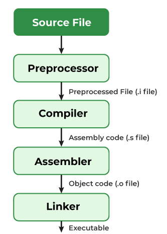
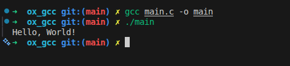
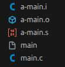
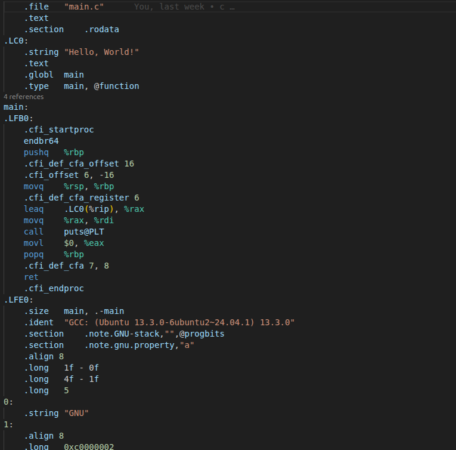
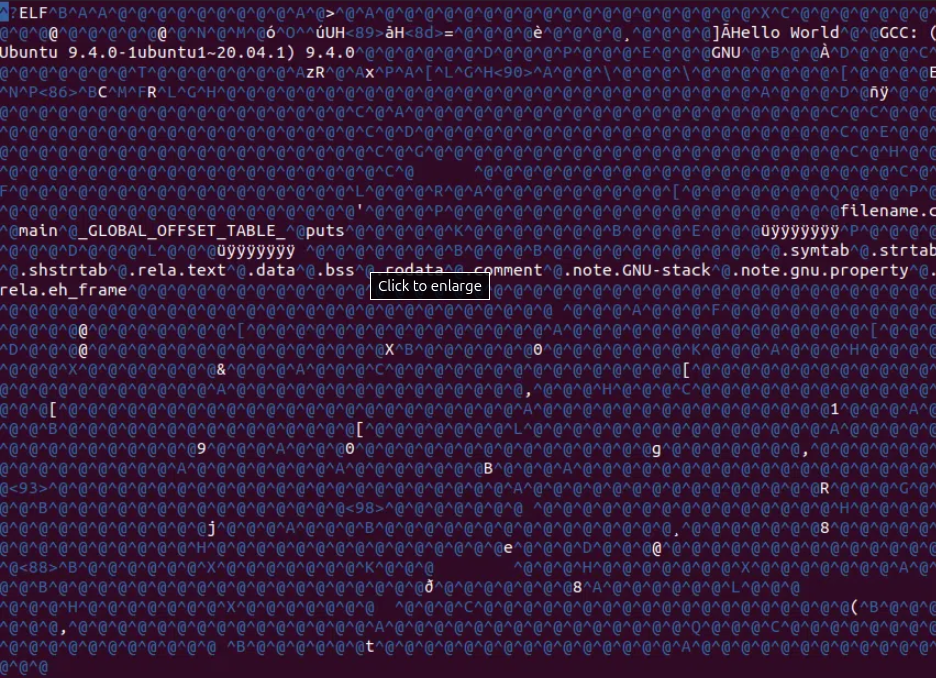

The compilation is the process of converting the source code of the C language into machine code. As C is a mid-level language, it needs a compiler to convert it into an executable code so that the program can be run on our machine.

The C program goes through the following phases during compilation:



Compilation Process in C

Understanding the compilation process in C helps developers optimize their programs.

# Steps to Compile and Run a C Program
We first need a compiler and a code editor to compile and run a C Program. The below example is of an Ubuntu machine with GCC compiler.

## Step 1: Create Source File

We first create a C program using an editor and save the file as main.c In linux, we can use vi to create a file from the terminal using the command:
```sh
touch main.c

subl main.c
```
Then write a simple hello world program and save it.


```C
#include <stdio.h>

int main() {
    printf("Hello World\n");
    return 0;
}
```
## Step 2: Compile using GCC Compiler

Use the following command in the terminal for compiling our main.c source file.

```sh
gcc main.c -o main
```
We can pass many instructions to the GCC compiler to different tasks such as:

- The option -Wall enables all compiler's warning messages. This option is recommended to generate better code. 
- The option -o is used to specify the output file name. If we do not use this option, then an output file with the name a.out is generated.

If there are no errors in our C program, the executable file of the C program will be generated.

## Step 3: Execute Program
After compilation, an executable file is generated.

```sh
./main // for linux
 main // for windows
 ```
The program will be executed, and the output will be shown in the terminal.



# Compilation Process
A compiler converts a C program into an executable. There are four phases for a C program to become an executable: 

- Pre-processing
- Compilation
- Assembly
- Linking

By executing the below command while compiling the code, we get all intermediate files in the current directory along with the executable.

```sh
gcc -Wall -save-temps main.c –o main
```

The following screenshot shows all generated intermediate files.



Below is the explanation for all the intermediate processes and files:

## 1. Pre-processing
This is the first phase through which source code is passed. This phase includes:

- Removal of Comments
- Expansion of Macros
- Expansion of the included files.
- Conditional compilation

The pre-processed output is stored in the filename.i. Let’s see what’s inside filename.i: using $vi filename.i 

In the above output, the source file is filled with lots and lots of info, but in the end, our code is preserved. 

- printf contains now a + b rather than add(a, b) that’s because macros have expanded.
- Comments are stripped off.
- #include<stdio.h> is missing instead we see lots of code. So header files have been expanded and included in our source file

## 2. Compiling
The next step is to compile filename.i and produce an; intermediate compiled output file filename.s. This file is in assembly-level instructions. Let’s see through this file using $nano filename.s  terminal command.



The snapshot shows that it is in assembly language, which the assembler can understand.


## 3. Assembling
In this phase the filename.s is taken as input and turned into filename.o by the assembler. This file contains machine-level instructions. At this phase, only existing code is converted into machine language, and the function calls like printf() are not resolved. Let’s view this file using $vi filename.o 



## 4. Linking

This is the final phase in which all the linking of function calls with their definitions is done. Linker knows where all these functions are implemented. Linker does some extra work also: it adds some extra code to our program which is required when the program starts and ends. For example, there is a code that is required for setting up the environment like passing command line arguments. This task can be easily verified by using size filename.o and size filename. Through these commands, we know how the output file increases from an object file to an executable file. This is because of the extra code that Linker adds to our program.

Linking can be of two types:

- Static Linking: All the code is copied to the single file and then executable file is created.
- Dynamic Linking: Only the names of the shared libraries are added to the code and then it is referred during the execution.

GCC by default does dynamic linking, so printf() is dynamically linked in above program.


https://www.geeksforgeeks.org/operating-systems/static-vs-dynamic-libraries/

https://www.geeksforgeeks.org/software-engineering/linker/

https://www.geeksforgeeks.org/operating-systems/working-with-shared-libraries-set-1/