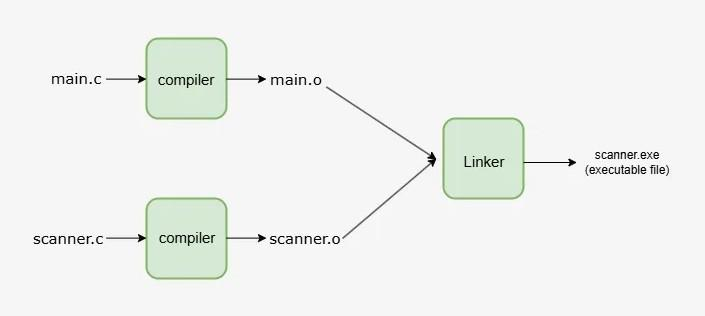

# Linker

A linker is an essential tool in the process of compiling a program. It helps combine various object modules (output from the assembler) into a single executable file that can be run on a system.

The linker’s job is to manage and connect different pieces of code and data, ensuring that all references between them are properly resolved.
This linking process happens in two stages: compile-time linking (when the source code is converted to machine code) and load-time linking (when the program is loaded into memory for execution).
Essentially, the linker bridges the gap between a program's individual parts and its final executable form, making it ready for execution by the system.\

- The linker’s job is to manage and connect different pieces of code and data, ensuring that all references between them are properly resolved.

- This linking process happens in two stages: compile-time linking (when the source code is converted to machine code) and load-time linking (when the program is loaded into memory for execution).

- Essentially, the linker bridges the gap between a program's individual parts and its final executable form, making it ready for execution by the system.

`Source code -> compiler -> Assembler -> Object code -> Linker -> Executable file -> Loader`

 Linking Process: Combining Object Files into an Executable

## Types of Linking
Linking is the process of connecting different parts of a program. There are two main types of linking:

### 1. Static Linking

- Static linking happens during the compilation of the program.
- It combines all the necessary code and libraries into one single file before the program is run.
- The linker takes all the object files and system libraries, and joins them together to create an executable file.
- Once linked, the program doesn’t need to depend on the original object files anymore.
- **Example:** If you are using some external functions in your program, static linking will include those functions directly into your final executable.

A static linker performs two major tasks to prepare a program for execution:

#### Symbol Resolution
- The linker makes sure that each symbol (like variables or functions) in the program refers to only one definition.
- It connects every reference to a specific place in memory where the symbol is defined.
- This ensures that when the program runs, it knows exactly where to find each symbol.

#### Relocation
- The linker changes the addresses of code and data sections in the program.
- It updates the memory locations to match the actual place where the program is loaded in memory.

### 2. Dynamic Linking
Dynamic linking happens at runtime, meaning it is performed while the program is running rather than during the compilation process.

**Library Linking:** Instead of including all the necessary libraries directly into the executable, the dynamic linker adds the names of shared libraries in the executable image. The actual linking happens when the program is executed.

**Advantages**
- **Memory Efficiency:** Multiple programs can share the same copy of a library, saving memory space.
- **Code Sharing:** If the same object or library is used in several parts of a program, it’s only linked once and shared across modules, reducing redundancy.
- **Flexible Linking:** The linker can adjust (or relocate) the memory addresses at runtime to ensure the code runs smoothly.

**Disadvantages**
- **Errors and Failures:** There are more chances of errors or failures because the linking happens at runtime. If the required shared library is missing or incompatible, the program may fail.
- **Non-relocatable Code:** Not all code can be relocated, meaning some addresses are fixed at runtime.

In dynamic linking, libraries are stored in virtual memory, which helps save physical RAM by sharing them across programs.

**Example:** If you open a program that uses a system library (like a graphics library), the program will link to that library when it runs.

## Features
- Symbol Resolution: The linker resolves symbols (such as function and variable names) that are used across different object files and libraries, ensuring that each symbol points to the correct definition.
- Optimization: The linker can perform optimizations like removing unused code (dead code elimination) and combining functions (function inlining) to improve the performance and reduce the size of the executable.
- Library Management: The linker only links the required functions from libraries, removing unused code to minimize the size of the executable.
- Debugging Information: The linker can include debugging information in the executable, making it easier for developers to debug and analyze the program during development.
- Cross-Platform Support: The linker can create executable programs that work on different platforms, such 

## Applications
1. Combining object files: The primary function of a linker is to combine multiple object files into a single executable. This allows for the efficient management and distribution of large software projects, as multiple object files can be combined into a single executable that can be run on a target platform.
1. Resolving symbol references: Linkers also resolve symbol references between object files. A symbol is a variable or function that is defined in one object file and used in another. The linker ensures that all symbol references are properly resolved, so that the final executable can run correctly.
1. Dynamic linking: Linkers also support dynamic linking, which allows a program to call functions or access variables that are defined in a separate shared library. This allows for more efficient memory usage, as multiple programs can share the same library.
1. Library management: Linkers also play an important role in library management. A library is a collection of object files that can be linked into a program to provide additional functionality. Linkers allow developers to easily link libraries into their programs, making it easier to add new functionality to a project.
1. Modularity: Linkers also allow for greater code modularity and reusability. By breaking a software program into multiple object files that can be linked together, developers can create more modular and reusable code.

## Advantages
1. Code Reuse: A linker allows code to be reused across multiple programs by linking in shared libraries, reducing the amount of code that needs to be written and maintained.
1. Smaller Executable Files: Dynamic linkers reduce the size of the executable file by linking libraries at runtime, rather than including them in the executable.
1. Reduced Memory Footprint: Dynamic linkers allow multiple programs to share the same library in memory, reducing the overall memory usage of the system.
1. Reduced Disk Space: With dynamic linking, the libraries only need to be stored on disk once, instead of being copied into the executable of each program that uses them.
1. Portability: Linkers allow multiple object files generated by different compilers or written in different languages to be combined into a single executable file, allowing for more flexibility and portability in program

## Disadvantages
1. Complexity: Linkers can be quite complex, especially when dealing with large and complex projects. This can make it difficult for developers to understand and troubleshoot issues that may arise.
1. Symbol resolution: Linkers must resolve symbols, which are names used in the source code that refer to memory locations. This can be a difficult and time-consuming process, especially when dealing with multiple object files and libraries.
1. Compatibility issues: Linkers must be able to work with a variety of object file formats and libraries, which can be challenging. Incompatible object files or libraries can cause errors or crashes during the linking process.
1. Performance: Linkers can be resource-intensive and may take a long time to process large projects. This can be a problem for developers working on large-scale projects or for embedded systems with limited resources.
1. Security: Linkers can also be a potential security risk if not properly implemented. Insecure linking can lead to vulnerabilities that can be exploited by malicious actors.