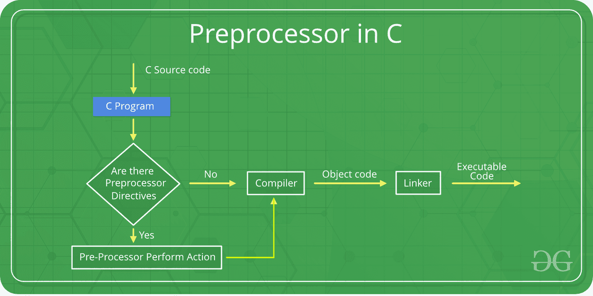
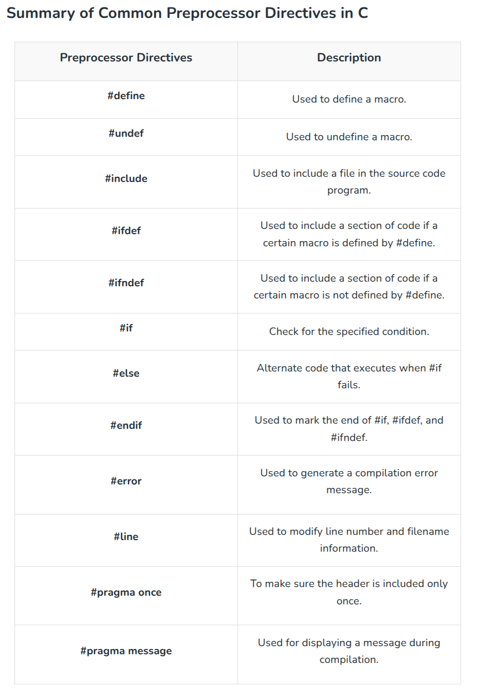

# C Preprocessor Directives

The C preprocessor is a program that processes the source code before actual compilation begins. It handles special instructions called preprocessor directives, which guide the compiler on how to prepare the code.

- Preprocessor directives start with the # symbol
- They are executed before compilation
- They are used for macros, file inclusion, and conditional compilation



# Preprocessor Directives in C

## #define

The #define directive is used to define macros or symbolic constants. These values are replaced before compilation.

- Used to define constants and macros
- Improves code readability
- No memory allocation happens

```c
#include <stdio.h>

#define PI 3.14159

int main()
{
    // Using the PI macro to calculate
    double r = 8.0;
    10double area = PI * r * r;

    printf("%f\n", a);
    return 0;
}
```
output:
```output
201.061760
```

## #include
The #include directive is used to include header files in a program before compilation.

- Allows use of library functions
- Supports reusable code
- Comes in two forms: < > and " "

sytax:
```Syntax

#include <filename>

#include "filename"
```

- < > -> system header files
- " " -> user-defined header files

```c
#include <stdio.h>

int main() {
    printf("Hello, Geek!\n");
    return 0;
}
```

Output:
```code
Hello, Geek!
```

## Conditional Compilation Directives (#if, #elif, #else, #endif)
These directives work together to control which parts of the program get compiled based on certain conditions.

- If the condition after the #if is true, the lines after it will be compiled.
- If not, it checks the condition after associated #elif. If that's true, those lines will be compiled.
- If neither condition is true, the lines after #else will be compiled.

```c
#include <stdio.h>

int main()
{
#define VALUE 2

// Check if VALUE is greater than 3
#if VALUE > 3
    printf("Value is greater than 3\n");

// Check if VALUE is 3
#elif VALUE == 3
    printf("Value is 3");

// If neither conditions are true, this
// block will execute
#else
    printf("Value is less than or equal to 2");
#endif

    return 0;
}
```
Output
```
Value is less than or equal to 2
```
>Note: the entire structure of #if, #elif and #else chained directives ends with #endif.

## #ifdef

The #ifdef (if defined) directive checks whether a macro is defined. If it is, the code within the #ifdef block is included in the program.

```c
#include <stdio.h>
int main()
{

#define DEBUG

// Check if DEBUG is defined
#ifdef DEBUG
    printf("Debugging is enabled");
#endif

    return 0;
}
```
Output
```
Debugging is enabled
```

## #ifndef
The #ifndef (if not defined) directive checks if a macro is not defined. If it is not defined, the code inside the #ifndef block is included.

```c
#include <stdio.h>
int main()
{

// Check if DEBUG is not defined
#ifndef DEBUG
    printf("Debugging is not enabled");
#endif
    return 0;
}
```
Output
```
Debugging is not enabled
```

## #line

The #line directive is used to change line number and file name for the compiler.

- Useful in generated code
- Helps in debugging
- Alters compiler reporting

#include <stdio.h>

// Define macro that prints current line number and filename
#define PrintLineNum printf("Line number is %d in file named %s\n", __LINE__, __FILE__)

```c
int main()
{
    PrintLineNum;

    // Change line number to 20 and filename to "main.c"
    PrintLineNum;

// Change line number to 30 and filename to "index.c"
#line 30 "index.c"
    PrintLineNum;

    return 0;
}
```
Output
```
Line number is 5 in file named ./Solution.c
Line number is 20 in file named main.c
Line number is 30 in file named index.c
```

Line number that will be assigned to the next code line. The line numbers of successive lines will be increased one by one from this point on. "filename" - optional parameter that allows to redefine the file name that will be shown.

## #error

The #error directive generates a compilation error with a custom message.

- tops compilation immediately
- used for enforcing conditions

```c
#include <stdio.h>

#ifndef GeeksforGeeks

// Show error message
#error "GeeksforGeeks not found!"
#endif

int main()
{
    printf("Hello, GeeksforGeeks!\n");
    return 0;
}
```
Output
```
error: #error "GeeksforGeeks not found!"
```

## #pragma - Pragma Directive
The #pragma directive gives special instructions to the compiler.

- Compiler-specific behavior
- Used for optimizations and warnings

Commonly used pragma directives are:

- #pragma message: used at compile time to print custom messages.
- #pragma once: to guard the header files i.e the header file must be included only once.
- #pragma warning: to enable or disable the warnings.
```c
#include <stdio.h>

// not defining gfg to trigger pragma message
// #define GeeksforGeeks

int main()
{
#ifndef GeeksforGeeks
#pragma message(" GfG is not defined.")
#endif
    printf("Hello geek!\n");
    return 0;
}
```

Output
```
#pragma message:  GfG is not defined.
```

